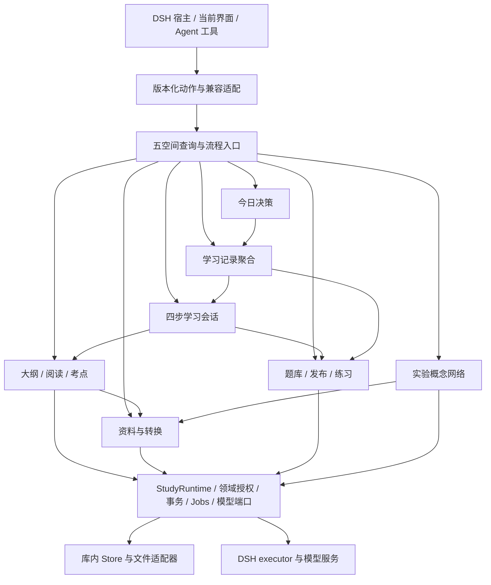

# StudyHub 后端重组方案：以五个空间贯通学习闭环

日期：2026-10-21（Asia/Shanghai）
状态：**用户已认可闭环并批准开始开发；B0、B1 已实施，B2–B7 待推进。**
目标工作区：`D:\Codex\workspaces\Study\studyhub-redesign`
检查基线：分支 `redesign/five-spaces`，HEAD `caf7eb3b`，另有未提交的 S1 接续改动。

## 1. 本轮目标和优先级

用户最新要求：暂缓前端开发，先规划后端架构和功能模块重组；**先融合目前冗余重复的功能模块，按五个空间规划整体学习闭环。**

因此本方案以功能收敛为主线：减少重复决策、重复知识结构、重复生成与重复学习记录。目录整理、接口统一和性能优化服务于这条主线，不单独成为大规模重写项目。

完成后的基本体验应当是：

> 今天决定下一步 → 资料提供可追溯依据 → 知识组织学习内容 → 练习检验掌握情况 → 记录沉淀结果 → 今天根据新结果调整下一步。

阅读、学习会话、练习可以从中途进入，不强迫用户每次走完五个空间。课程切换只改变浏览范围；已经开始的学习和任务保留原课程、原对象与原资料版本。

本轮只交付设计与分阶段路线。当前前端工作保留在原工作区，暂停修改和交付，不据此宣称 S1 已验收完成。后端实施沿用当前会话逐项实现、完成后独立审查的偏好，但新的实施范围须以本方案审核后的任务计划为准。

### 1.1 延续的产品决定

依据 [五空间正式设计](2026-10-20-studyhub-ia-ui-restructure.md) 的 D1–D7：

- 保留“今天、资料、知识、练习、记录”五空间，以及设置和公共活动中心。
- 学习流收敛为讲解、复述、练习、总结四步；移除自定义编排和重复生成骨架。
- 知识空间以大纲为结构主线，承载阅读和考点；知识骨架退役并提供导出。
- 课堂实录、Jev、全局笔记本、CSDN 公开笔记按已批准方向退役。音频文件转写、口试、案例题、今日总结和陪学能力保留。
- 资料概念网络保留独立模块，实验入口默认关闭；本轮不提升为正式上线功能。
- D5 优先于旧文档中的上游合并设想：在独立重构分支工作，不先合并上游。
- 既有学习数据和文档保留。真实 DSH 与真实学习库不作为开发、迁移或验收目标。

### 1.2 本方案提出的新设计

以下是建议，尚不是已完成的功能：统一今日决策服务、课程内容门面、四步会话模块、学习记录聚合查询、公共活动查询、资料处理职责迁移，以及相应的版本化接口与迁移规则。

## 2. 当前后端：可以复用什么，重复在哪里

以下依据当前工作区源码核对。旧 `docs/architecture.md` 有早期模块数量与插件清单，不能直接当作当前完整清单。

| 部分 | 已有实现 | 重组判断 |
| --- | --- | --- |
| 宿主与插件 | `lib/index.js`、`lib/host.js`、`lib/plugins/*` | 继续采用 DSH 插件；无需另建 Web 后端 |
| 统一运行时 | `lib/runtime.js`、`runtime/lifecycle.js` | 已有按库运行时、版本化 API、权限、事务、能力发现，继续复用 |
| 兼容入口 | `lib/service.js` 的 `StudyService` | 已是门面，不重新扩展为业务大类 |
| 领域边界 | `runtime/domain-contracts.js` 的 fields、reads、grants、writesFor | 已有数据所有权；新功能必须声明最小读写范围 |
| 组合中心 | `runtime/builtins.js` | 同时处理注册、端口、任务和提交后组合；按领域拆出注册描述，保留一个装配入口 |
| 资料 | `contexts/materials/*`、文档与原文模块 | 保留原文、文本投影、revision、引用定位，作为所有内容的依据 |
| 课程内容 | `course-outline*`、`course-book*`、`exam-point-list*`，操作分布于 library、materials、generation | 统一业务门面，复用已存在的大纲与样卷支持，不新建第三套结构 |
| 概念网络 | `contexts/knowledge/*`、`runtime/knowledge-composition.js` | 已有独立集合、任务、证据、合并和问答；保持与题库解耦 |
| 学习编排 | `contexts/workflows/*`、`workflow-*`、coach、daily-plan | 多个“开始学”和“下一步”来源需要合并 |
| 题库与练习 | bank、authoring、study、`mastery.js` | 保留内容、发布事务、评分和 SM-2；避免再做一套掌握度 |
| 任务 | `lib/jobs/*`、`runtime/jobs.js`、各域 job definitions | 已有取消、恢复能力声明、持久化和 DSH executor，统一接入而非另造队列 |
| 聚合与管理 | `contexts/library/operations.js` | 混合 snapshot、课程内容、统计、资料、历史与备份，需逐项迁出业务职责 |
| 音频与转换 | `contexts/audio/*` 同时包含转写、PDF 转换和安装任务 | 产品上归到资料，内部区分转写与文档转换，兼容既有动作 |
| 记录与通知 | notes、inbox、runs、attempts、workflowSessions、board | 合并查询与入口，保持事实记录的唯一归属 |

**发现的关键事实：**

1. 课程大纲已经支持样卷输入、考点依据和知识点锚点；复习全书也已有稳定标题 ID、人工编辑保护、未归位内容和版本历史。应收敛这些能力，而非重写知识内容系统。
2. 现有大纲、全书等生成结果使用带 provenance 的 source 记录。它们不是原始证据；不能重新送入资料抽取形成循环自证。
3. `course.book.open` 可能初始化或同步内容，`document.get(refresh)` 也可能更新资料版本。接口名字带 open/get 不代表纯读取，重组时要显式标注。
4. Store 当前为 v4，支持扩展集合及缺失插件数据保留；此外还存在附件、全书历史、任务持久化等文件。
5. `lib/board.js` 将待办存于 DSH home 的 `study/board.json`，`lib/notebooks.js` 的注册表也在宿主目录。它们不是普通的库内集合。
6. S1 尚有收尾问题。当前 `focus.set` 在省略 course 时调用 `currentCourse`，会把保存的 `'*'` 聚合选择变成 `null`；应纳入后端范围契约修复。其余前端审查遗留另行保留，不在本轮规划中顺带修改。

## 3. 架构选择

| 方案 | 收益 | 代价 | 结论 |
| --- | --- | --- | --- |
| 在现有运行时上做模块化重组 | 保留 DSH、Store、任务和旧接口；可逐阶段迁移 | 需要清晰的兼容期和数据归属 | **推荐** |
| 直接做五个大型后端模块，每个空间包办全部逻辑 | 与页面名称一致 | 课程、生成、任务和记录仍会重复；页面调整影响核心业务 | 不采用 |
| 新建独立 API 服务、数据库和消息队列 | 可独立部署和扩容 | 同时引入数据迁移、跨进程事务和 DSH 适配，不能直接解决功能冗余 | 本轮不采用 |

推荐架构：**单进程、按学习库隔离的模块化后端；五空间查询入口在上层，业务模块与共享运行时在下层。** 五空间不是五套存储，也不需要五个微服务。

图中箭头表示调用或读取方向，不表示循环消息流。学习闭环通过已提交的数据和下一次查询实现，不让“记录更新→推荐→自动练习→记录更新”无限触发。

## 4. 五空间的后端职责和闭环

| 空间 | 回答的问题 | 统一的后端输出 | 写入落点 | 返回闭环的方式 |
| --- | --- | --- | --- | --- |
| 今天 | 我现在该做什么？ | 一个主行动、至多三个次行动、原因、每日时长、继续对象 | 今日设置；真正开始时调用会话或练习模块 | 读最新学习结果重新决定下一步 |
| 资料 | 学习依据是什么，能生成什么？ | 原文、版本化文本、处理状态、可用生成目标 | materials；转写结果与任务由各自模块持有 | 资料准备好后可生成大纲、讲解或题目 |
| 知识 | 这门课如何组织，哪里需要理解？ | 同一大纲的结构、阅读、考点三种投影；练习证据；可选概念网络 | 课程内容经 materials 的受限端口发布；概念网络独立存储 | 从同一节点阅读、启动会话或进入练习 |
| 练习 | 我掌握了吗，下一步补哪里？ | 统一题库、草稿发布、待巩固、考试及结果 | bank、study；跨域发布由 authoring 协调 | 保存真实作答，更新现有排程和掌握证据 |
| 记录 | 学过什么、结论是什么、还要做什么？ | 会话历史、笔记、总结、统计与待办的统一查询 | 笔记归 notes；事实仍归 study/session；待办暂保留宿主存储 | 结果供今日决策和大纲掌握度读取 |

### 4.1 三条必须贯通的旅程

**新资料进入：** 导入 → 原文/文本校验 → 选择生成大纲或题目 → 生成结果校验与发布 → 在知识中阅读或开启会话 → 练习 → 记录 → 今日建议更新。资料导入成功和生成成功分别报告；模型不可用时仍可管理、阅读和练习已有内容。

**已有课程继续学：** 今天返回已有的暂停会话或练习 → 原对象恢复 → 讲解/复述/练习/总结 → 保存结果 → 课程进度和下一步更新。切换全局课程不重绑正在进行的会话。

**薄弱点巩固：** 待巩固定位真实错题/薄弱主题 → 跳到对应大纲节点或资料片段 → 复习讲解 → 使用现有题目再练，或由用户启动补题并审核发布 → 记录新的作答。读过讲解、模型评价好、总结完成，均不能直接把题目标记为已掌握。

无题库时，资料和知识阅读仍可用；会话到练习步明确报告“暂无可练题”，允许记录跳过，不能伪造练习完成或掌握度。

## 5. 冗余功能融合清单

| 现有重复能力 | 统一后归属 | 保留能力 | 收敛/退役内容 |
| --- | --- | --- | --- |
| 首页今日卡、推荐下一步、下一步侧卡、DailyPlan、待办中的 AI 安排 | 今日决策 | 继续学习、到期复习、每日时长、选择原因 | 多套推荐与 AI 协商安排 |
| 课程跟学、先讲后练、学习流入口、workflow.quickstart | 四步学习会话 | 讲解、复述、练习、总结；讲解改写/撤销；暂停恢复 | 自定义流程编辑、分支编排、AI 另挑主题、自动骨架 |
| 总纲、全书、备考补习 | 课程内容模块 | 一份大纲、阅读文本、考点及样卷证据 | 独立考点树的持续生成和独立业务入口 |
| 骨架、旧题库图谱、首页学习目录 | 大纲 + 题库维护 | 大纲结构；题库目录、主题归并和质量检查 | 骨架结构编辑、Archify、重复掌握树；历史保留导出 |
| 错题、待巩固、推荐题、定制/变式题 | 练习补强服务 | 同一候选集、来源原因和用户选定后的生成 | 多处独立推荐与重复生成 |
| 用资料出题、选择片段补题、补漏、大纲/全书生成 | 统一生成入口 + 各类型生成器 | 各任务的独立校验、进度、取消、恢复能力 | 重复的调度、模型接入和发布逻辑；不把所有提示词并成一个 |
| 学习笔记、每日总结、会话历史、做题笔记 | 记录聚合 | 统一检索和关联；保留原类型 | 多份复制的作答或会话状态 |
| 任务、信箱、待发布提醒 | 活动聚合 | 统一查询及对象跳转；各来源保持权威状态 | 同一任务完成被显示为多条独立待办 |
| PDF 转换和音频转写混在 audio | 资料处理层 | PDF/Office/文本导入、录音文件/字幕转写 | live 实时转写按原批准退役；转换不再依赖音频业务接口 |

“融合”不能只改名字或移动文件。每项验收至少证明：只有一个权威决策/状态来源，旧入口委托同一实现，失败和重试不会产生第二份业务结果。

## 6. 目标业务模块与依赖

### 6.1 保留的基础模块

- **materials**：拥有 sources/documents、原文附件和版本化文本。负责引用定位和资料有效性；不主动调用课程内容或概念网络。
- **bank / authoring / study**：分别负责题目内容、跨域发布、作答与评分。沿用现有 SM-2 和 attempts，外部模块不得直接修改掌握状态。
- **courses / system**：课程身份、别名、课程状态与设置；焦点选择继续有明确所属，不能各空间各存一份。
- **knowledge**：只承担资料驱动概念网络及证据问答。大纲节点 ID 与概念 ID 不等同，不强行合并两种模型。
- **jobs / notifications**：保持任务和通知的唯一状态源。活动中心只是投影。
- **runtime / host / store**：继续负责装配、权限、生命周期、模型服务、锁与持久化。

### 6.2 新增或收拢的业务边界

**课程内容 `curriculum.v1`（建议新增）**

统一大纲、阅读、考点的查询和编辑编排。初期复用 source 中既有 course-outline/course-book-doc 等表示；不把 sources 所有权从 materials 拆走。读取经声明的快照端口，写入通过材料模块的窄发布接口或明确事务参与者。既有 library 的 `course.outline`、`course.book.*`、`book.*` 保留兼容路由。

将样卷证据作为大纲的标注层。旧考点映射先使用稳定锚点和已有 ID；仅标题相似不能自动确认。无对应节点、重名或一对多不确定内容保留为“未归入”，人工确认结果持久化。对同一旧清单和目标大纲 revision 重跑不得重复创建标注。

**学习会话 `learning-session.v1`（建议新增）**

拥有新的 `learningSessions` 扩展集合，四步状态固定，保存目标、资料依据、讲解、复述、练习 runId、总结和 version。会话拥有流程状态，study 拥有练习结果；启动练习及写入 runId 使用明确的跨域事务，避免双击生成两个练习。

学习目标限定为大纲节点或已有题库主题，入口来源为今天、知识或待巩固。状态为 active / paused / completed，步骤为 explain / retell / practice / summary；“跳过”单独记录，不能等同通过。回看前一步不清除已保存内容。

**今日决策（先做纯规则模块）**

先作为独立纯函数由查询层调用，不立即注册一个有存储的新 context。输入已提交的课程范围、运行中对象、到期/薄弱/新题和时长；输出一个主行动及至多三个次行动，全部带原因和目标引用。

优先保留已有文档规定的“继续未完成练习 → 继续课程批次 → 继续今日学习 → 下一批课程学习”顺序；四步会话纳入“继续学习”候选，同级按最近活动排序。未激活课程不主动推荐。跨课程的未完成练习仍可以推荐，但必须显式带课程，不暗改全局选择。空课程/无题时返回阅读、准备资料等可执行行动。到期复习保留明确次入口；这一阶段不另换排序算法。

**记录与活动查询（建议新增查询模块）**

记录读取 notes、study、session 和课程信息，返回来源 ID 与类型；不复制 attempts。活动读取 jobs、inbox 和 drafts，用稳定关联键折叠同一任务的完成提醒；已读、归档、取消、删除仍调用原所有者。待办通过宿主适配器接入，暂不改变已有跨工作区数据归属。

**资料处理与生成**

先把 PDF 转换从 audio 的业务职责中抽出，保持原 job kind、持久化路径和旧动作兼容。音频文件转写继续独立实现，结果统一发布为资料。

generation 保留生成入口、任务定义和模型编排；具体类型仍分为题目、大纲、讲解、补强、翻译、总结。每种类型负责自己的输入/输出校验，成功后向内容所有者发布。模型 SDK、凭据与调用计量不散落到各模块。

### 6.3 依赖规则

1. 聚合查询可以读取多个模块，但不能拥有它们的业务状态。
2. 跨模块调用必须出现在依赖与动作授权声明中；领域实现不接收 unrestricted Store 或 StudyService。
3. 课程内容只读取题库的关联与掌握投影；学习会话调用课程内容和 study；记录读取会话与 study；今日决策读取这些投影。底层模块不反向依赖今日决策。
4. 资料提交后的知识失效/重建由 runtime 组合层触发，复用当前 knowledge 对账机制；不引入通用消息总线或分布式事务。
5. 移动源码文件不等于改变插件安装边界；现有 package exports、独立安装及卸载语义要保留到兼容验收结束。

## 7. 接口与数据契约

### 7.1 统一范围与对象引用

新接口使用显式 `scope`：`{ kind: 'all' }`、`{ kind: 'unassigned' }`、或 `{ kind: 'course', courseId, includeDescendants: true }`。隐式父课程尚无课程记录时，由适配器解析已存在的课程路径并返回成员 ID；不能把路径字符串伪装成 courseId。

旧 `focus.set` 的 `'*'`、空字符串、null 分别保持“全部”“未分类”“恢复默认”语义。省略 course 必须保留原选择。新接口把浏览范围和学习目标分开；范围全部不意味着把不同课程合并生成一份全书。

对象引用包含 `kind`、稳定 ID、所属课程，以及必要的 revision。会话/生成启动后固定目标，不能每一步重新读取全局 focus。库身份来自当前运行时绑定，客户端提交的库路径不得替代绑定。

### 7.2 建议接口清单

下列为**拟新增接口**，不是当前已经可调用的动作；最终 schema 在对应阶段的实施计划中冻结。

| 模块/操作 | 主要输入 | 主要输出和约束 |
| --- | --- | --- |
| `learning.today.get` | scope、当前时间 | primary、secondary、reason、目标引用；纯读取、无模型 |
| `curriculum.get` | 单课程或节点、视图类型 | outlineRevision、结构/阅读/考点；只读 |
| `curriculum.prepare` | 单课程、expectedRevision | 显式初始化或同步，承接旧 open 的写行为 |
| `curriculum.examPoints.preview/apply` | 旧清单、目标大纲 revision、确认映射 | 匹配、歧义、未归入；apply 校验 revision 和幂等键 |
| `learning.session.start/get/advance/pause` | 目标、requestId、会话 version | 会话状态；并发修改返回明确版本冲突 |
| `learning.session.practice.start` | sessionId、version、requestId | 同一会话步骤的 runId；重复请求返回同一结果 |
| `learning.records.query` | scope、类型、cursor、limit | 有界记录摘要、来源引用、下一页 |
| `activity.query` | 过滤、cursor、limit | 去重的活动投影和来源专属可执行动作 |
| `legacy.export` | 类型、对象 ID、格式 | 骨架/旧流程/旧考点的 JSON 或 Markdown，不改变原数据 |

新查询默认 limit 50、上限 200；知识图查询继续保持既有专用上限，不用这个通用分页值覆盖图契约。cursor 绑定查询范围与数据 revision，数据变化后返回可识别的失效结果，由调用方重新查询。

既有动作保持返回形状，兼容层转换输入并委托新实现。新接口的冲突、目标删除、资料过期、模型不可用、executor 不可用分开报告；不能把模型失败返回成空成功。现有 `{ available: false, reason: ... }` 与抛错约定在兼容入口保持，不强迫全项目一次性换错误格式。

### 7.3 单一事实源与版本

| 信息 | 权威来源 | 禁止出现的第二份状态 |
| --- | --- | --- |
| 原文和证据有效性 | materials 的身份与 revision | 全书或图谱自己宣称旧引用仍有效 |
| 大纲结构、阅读、考点 | curriculum 经 materials 管理的内容记录 | 独立备考树持续与大纲竞争 |
| 题目、草稿 | bank | 会话内部维护另一套可编辑题库 |
| 作答、评分、复习排程 | study + 现有 bank schedule 事务 | 记录页或模型总结直接加掌握度 |
| 四步进度 | learningSessions | notes 再维护一个会话完成状态 |
| 任务执行状态 | 现有 Jobs | inbox 或活动查询推断任务成功 |

资料变更后，旧内容可供历史查看，但应标注依据旧版本。模型执行在事务外；发布前在存储锁内再次核对资料 revision、目标 revision、取消状态和幂等键，防止迟到结果覆盖新内容。

生成文本、人工编辑文本、问答追加文本的现有分层继续保留。大纲重建不能删掉人工文字，无法映射的放入未归位；重命名课程不能只修改显示字段而遗漏内容、会话与历史关联。

## 8. 任务、模型与提交后联动

- 复用现有 Job framework、DSH executor、模型 gateway、用量计量和恢复能力声明；短查询不转后台任务。
- 导入、转换、生成、发布各自有结果回执。已成功导入而自动知识构建失败时，资料仍然成功，后续任务单独显示失败原因。
- retry 从声明的恢复点开始；只支持整项重跑的任务不能显示“断点续跑”。取消后不得发布新的内容；已经提交的结果按既有任务契约呈现。
- 请求幂等键按库、操作、目标、输入版本限定。相同请求重复执行返回原结果；用户明确选择“重新生成”产生新请求。
- 练习完成后，attempts 是事实；总结失败不回滚作答。总结去重引用 runId 或 sessionId，重试不得生成多份相同每日总结。
- 先复用已有知识持久化意图与对账、notes 的总结机制；若新增联动需要持久化恢复，只增加该业务所需的回执，不建设通用事件平台。
- 开发验证使用私有 DSH home。需要真实模型验收时，使用用户指定的兼容接口与 `gemini-3.8-flash-high`；密钥从本地运行配置注入，不写入源码、测试夹具或本文。
- 模型返回结构、引用和目标 ID 都要验证；大纲/考点映射不能以“模型说匹配”代替来源证据。

## 9. 迁移与兼容期

### 9.1 前端暂停期间

后端新增能力先通过 API/脚本验收，旧界面继续调用旧动作。不能为了收敛公开动作，立即移除仍被当前前端使用的 handler。兼容动作最终下线属于前端恢复后的整体验收阶段。

旧入口、Agent 工具、能力发现、preset、技能描述统一维护一份动作去向表。兼容期保留旧操作；最终退役时不再出现在新能力发现和工具说明里，直接调用应得到明确退役信息或安全的兼容转发，不能落入不存在的 handler。

### 9.2 旧数据处理

- **旧学习流：** 能无歧义映射到固定四步的旧会话，在用户选择继续时显式迁移；保存 legacyId、迁移版本与旧记录。分支/重复步骤等无法等价映射的只读查看，可重新开始新会话。不得静默截断步骤。
- **旧考点：** preview → 用户确认或确定性匹配 → apply。保留原清单；计数与原项 ID 可逐一对账，匹配不上的有独立列表。
- **旧骨架：** 停止新建之前先提供 JSON/Markdown 导出及引用清单；题库维护能力迁走后才退役骨架写动作。
- **旧记录和笔记：** 统一查询，不批量复制。CSDN 关联元数据保留在导出中，退役的是发布/外链管理能力，不删除本地笔记。
- **全局笔记本、待办：** 全局笔记本注册能力按原决定退役，注册记录保留；待办继续使用现有宿主存储和工作区引用，不把全局待办默默拷进某个学习库。
- **新集合：** 使用 Store.registerCollection 与自身 schemaVersion；仅新增集合不要求提升 Store 容器版本。旧记录格式变化需单独迁移器，不能借“v4 不变”省略迁移。

### 9.3 备份与回退

实施前记录代码基线、已有未提交改动和隔离数据快照。每阶段先 dry-run 输出对象数量、匹配、冲突和未归入情况，重复执行必须稳定。

库内迁移覆盖主 manifest、扩展集合、原文附件、全书历史、仍被引用的骨架附件及实际涉及的任务持久化文件。宿主配置、board、notebooks 与凭据单独列出，库备份不能宣称涵盖它们；不随库导出秘密配置。

回退必须配套代码与数据版本。在隔离副本上验证新版本写入后的备份恢复及旧入口可读性。不能以“旧程序保留未知集合”推断旧程序能理解新会话。若阶段迁移后不能供旧版继续编辑，应在阶段报告明确标记，并保留迁移前副本。

## 10. 后端实施路线

这是按功能融合组织的阶段路线，尚不是逐文件、逐测试的执行指令。每阶段完成后再进入下一阶段；详细实施计划在设计确认后按阶段编写。

| 阶段 | 要交付的业务结果 | 主要代码范围 | 完成标准 |
| --- | --- | --- | --- |
| B0 范围与兼容基线 | 固定五空间范围语义和旧动作去向 | focus、courses、runtime contracts、回归夹具 | 全部/未分类/父子课程/未激活课程可区分；补齐聚合选择保存缺陷；无生产库写入 |
| B1 知识结构融合 | 大纲、阅读、考点由课程内容门面提供 | 新 curriculum；course-outline/book；generation/outline、blueprint；library 适配 | 一棵结构承载三类结果；旧全书编辑受保护；旧考点匹配与未归入可对账 |
| B2 四步学习会话 | 讲解→复述→练习→总结，替代重复学习编排 | 新 learning-session；workflows 兼容；study 授权事务 | 重复启动不重复创建；暂停恢复；无题可跳过但不冒充完成；旧复杂流程可读可导出 |
| B3 练习补强与记录闭环 | 薄弱结果只算一次，能回到资料和知识 | study/bank 查询；notes；新 records 聚合 | 真实作答更新现有掌握度；记录回链到会话/题目/证据；总结失败不丢作答 |
| B4 今日决策融合 | 由一个函数提供下一步和继续入口 | 新 learning/today；library snapshot 兼容；daily-plan/coach 接入 | 一个主行动、至多三个次行动；理由稳定；完成 B2/B3 后可观察到下一步变化 |
| B5 资料处理与生成入口融合 | 转换/转写/生成各有职责，结果进入同一闭环 | audio/pdf 抽离；materials；generation；旧动作适配 | 导入失败不创建伪资料；转换成功生成失败仍可读原文；重试不重复发布 |
| B6 活动与退役准备 | 统一任务/提醒查询，完成旧功能导出与退役清单 | jobs、notifications、library、legacy export、host、工具描述 | 同一任务不重复提醒；导出覆盖旧对象；前端暂停期间所需动作仍兼容 |
| B7 隔离验收与交付 | 完整五空间后端旅程、迁移回退、代码审查 | tests、QA、打包、文档 | 下述验收矩阵通过；GitHub 独立分支可追溯；前端恢复条件清晰 |

顺序理由：先统一知识对象，学习会话才有明确学习目标；会话与练习产生记录后，再让今日决策读取完整结果。现有资料导入和任务框架先复用，因此无需等待 B5 才打通闭环。模块职责拆分随业务阶段发生，避免先全库搬文件。

B1、B2 各有独立设计细节和实施计划；后续阶段根据已落地契约细化。当前不承诺未经验证的工期。首个可演示的完整闭环是 B0–B4，B5–B7 收拢处理链路并完成交付。

## 11. 验收矩阵

| 场景 | 必须证明的结果 |
| --- | --- |
| 空库导入资料，无任何题组 | 资料、知识结构和阅读可以工作；练习能力如实为空 |
| 同一课程的大纲、全书与考点 | 使用同一节点引用；每条旧考点均为已映射、歧义或未归入，不丢项 |
| 完整学习闭环 | 导入→知识→会话→作答→记录→今日建议能由实际 API 串通 |
| 薄弱点回流 | 错题回链到知识/资料；复习后新作答更新现有排程，旧记录保留 |
| 多课程与切库 | 浏览范围不重写已运行会话；运行时、缓存、任务均不跨库串数据 |
| 资料更新/删除/归档 | 旧引用明确过期；迟到模型结果不能覆盖新 revision；人工笔记保留 |
| 并发与重复提交 | 双击、重试、重复完成通知不增加重复 run、attempt、考点标注或总结 |
| 模型不可用/返回非法结构 | 可读功能继续；任务如实失败；无伪成功、无未验证证据发布 |
| 重启与取消 | 按任务声明恢复或重新开始；取消与发布竞态有明确结果 |
| 旧数据兼容 | 骨架/旧会话/考点/笔记可查看或导出；未知扩展集合未丢失 |
| 备份恢复 | 隔离副本恢复后原文、历史和引用可核对；宿主数据边界清楚 |
| 插件组合 | 缺少 bank、knowledge、generation 等可选模块时能力发现准确，核心查询不崩溃 |
| 性能 | 用同一夹具比较迁移前后查询耗时、snapshot 大小和写入范围；结构/文本/线程不塞进轮询快照。阶段性回退超过 10% 的指标须分析并说明是否接受，不能仅凭一次计时宣称性能提升 |

复用现有 `architecture-boundaries`、`runtime-contracts`、`plugin-composition`、`store-extensions`、`runtime-transaction-isolation`、knowledge、outline/book、workflow 和 unified-runtime 测试体系。旧功能退役后调整测试入口，但保留数据、权限、事务、恢复与引用准确性断言。

最终验收使用 `scripts/qa/dsh-runtime-smoke.mjs` 和专门的学习闭环旅程，全部绑定私有 home 与库。用户提供的 `C:\Users\ZKR\Downloads\全套精炼版本` 作为只读真实资料输入；记录实际文件清单、哈希和处理结果，不预设数量，也不把其作为开发库。

真实模型验收、确定性夹具测试、浏览器兼容验证、隔离 DSH 验收分别报告，互不替代。前端暂停期间无需新 UI，可用结构化 API 验收；现有界面的兼容冒烟测试也不等于前端重构已完成。

## 12. 前端恢复开发的条件

满足以下条件后再规划前端接入：

1. 五空间的查询与写动作清单、对象 ID、课程范围、错误与任务回执已冻结。
2. B0–B4 的学习闭环通过 API 验收，有真实结果可供界面使用。
3. 兼容动作去向和退役时间点明确，旧数据能读取或导出。
4. 再处理当前 S1 残余：课程切换状态、异步页面结果过期、窄屏标签与切换稳定性等，避免 UI 接到尚不稳定的业务模型。

活动中心、下线页面和旧导航重定向将在前端恢复阶段接入。当前只规划后端，不将任何前端未完成项标记为已验收。

## 13. 本方案审核重点

- 是否同意按“知识融合 → 四步会话 → 练习与记录 → 今日决策”先形成最小闭环，再收拢资料处理与活动中心？
- 是否接受课程大纲是结构主线、概念网络是独立实验能力，二者共享证据但不合并为同一种数据模型？
- 是否接受兼容期保留旧动作，待前端恢复接入且历史数据导出验证完成后，再正式退役重复能力？

这些是方案中的关键取舍；用户可直接修改任一项。下一步是将确认的首阶段转换为可执行任务计划，而不是立即改代码。

## 14. 来源与核查范围

- 产品依据：[五空间设计](2026-10-20-studyhub-ia-ui-restructure.md)、[S1 接续范围](../plans/2026-10-20-s1-takeover.md)。
- 源码依据：本文第 2、6、7、9 节所列文件；重点查看 runtime、domain-contracts、builtins、service、Store、library operations、knowledge operations/scheduler、course-outline/book、workflow operations、board 和 notebooks。
- 历史交接 `studyhub-dev/HANDOFF-KNOWLEDGE-GRAPH.md` 用于理解约束，其“模块尚未创建/0 个任务”是当时状态，不适用于当前源码。
- 本轮进行静态架构梳理和文档自审，没有重新运行产品测试、真实模型任务或 DSH 部署；本文所有验收项均为后续实施标准，不是本轮测试通过记录。
