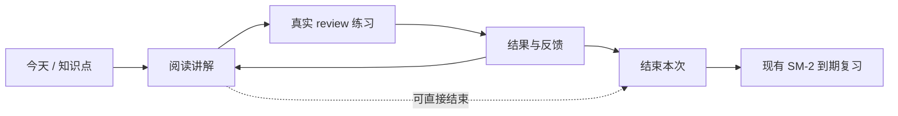

# 学习板块：课件阅读、练习与结果

创建日期：2026-10-23；修订日期：2026-10-24（Asia/Shanghai）。工作区：studyhub-redesign；产品基线提交：584e25ae；本次修订基于设计提交 07d952cb。
状态：按用户要求修订设计，尚未实施。用户已选择先学后测、允许直接做题，并认可复用现有 review、作答记录与 SM-2 的架构。本次落实自审的五项 P1 与两项 P2：图片资源保存、练习批次、任务交接、版本校验、请求幂等、查询所有权和统计口径。2026-10-23 的单次生图探测仅证明当时接口可用，不代表产品验收。

## 1. 目标与已确认决定

把固定的 explain → retell → practice → summary 表单改成以内容为主的学习体验：先读讲解，需要时就地问，随时开始实际练习，结束后自动看结果，再由现有排程安排复习。

- 移除独立复述环节、跳过原因和学习依据面板；笔记与总结均不作为推进条件。
- 会话位置只有 reading / practice / results；生命周期只有 active / paused / completed。产品分别显示阅读中 / 练习中 / 结果，进行中 / 已暂停 / 已结束。
- 学习会话只管理目标、位置、运行关联和暂停结束，不另建题库、评分、掌握度、排程或聊天系统。
- 继续同一课程、目标和资料版本的未完成会话，保留刚完成的防重复开始与请求重放规则。
- 旧会话中的复述、总结、笔记、作答、请求回执完整保留；结束本次学习不表示已经掌握。
- 复杂机制讲解时可以按需生成配图，用户也可以主动要求画图解释。文字继续使用 gemini-3.8-flash-high，图片走同一本地后端的独立图像模型能力，不另建教学或内容库。

## 2. 参考依据与适配范围

### 2.1 Study-Mate

参考仓库：https://github.com/Miaotofu01/Study-Mate 。本次通过 GitHub 页面、原始文件和树 API 阅读，树快照为 d8114f38363272852b339d6788b2f8f007243b43。属于源码与文档研究，未安装或运行该项目。

主要参考：

1. [课件设计规范](https://github.com/Miaotofu01/Study-Mate/blob/d8114f38363272852b339d6788b2f8f007243b43/preset/skills/lesson-design/SKILL.md)：教材式说明，解释概念的条件、推理、例子和边界，按内容组织小节，有用时配图，不机械套模板。
2. [局部提问规范](https://github.com/Miaotofu01/Study-Mate/blob/d8114f38363272852b339d6788b2f8f007243b43/preset/skills/local-qa/SKILL.md)：围绕正在读的内容答一小段，答后仍在原阅读位置。
3. [课件内容格式](https://github.com/Miaotofu01/Study-Mate/blob/d8114f38363272852b339d6788b2f8f007243b43/docs/规范/课件内容格式.md)：内容与呈现分离，讲解和题目分工，题库保持唯一来源。
4. [阅读端呈现](https://github.com/Miaotofu01/Study-Mate/blob/d8114f38363272852b339d6788b2f8f007243b43/docs/规范/阅读端呈现.md)：正文优先、辅助区按需展开、选段上下文明确、阅读不中断。

借鉴内容和交互原则，不照搬其目录、题型、学习进度判断或专用 Markdown 指令。该项目以数学和计算机学习为主；StudyHub 还承载生理等课程，讲解需要适配概念、机制、比较和情境应用。

### 2.2 学习研究

[Dunlosky 等 2013](https://journals.sagepub.com/doi/10.1177/1529100612453266)支持把练习测试和分散练习作为核心；[IES 实践指南](https://ies.ed.gov/ncee/wwc/PracticeGuide/1)建议结合解题示例和独立作答。研究支持原则，不给本产品固定题量、固定讲解字数或某个掌握分数背书。

## 3. 架构选择

| 方案 | 优点 | 代价与判断 |
| --- | --- | --- |
| A. 在现有大纲、全书、局部解释和 review 上组成学习界面 | 知识点与内容同源，编辑和解释可复用，题与评分仍只有一份 | 需要拆出阅读组件和调整会话状态；本文采用，符合用户已确认的职责收敛方向 |
| B. 新建独立讲解库和一套课程阅读器 | 可以完全独立设计 | 与已有全书、个人补充和版本历史重叠，不采用 |
| C. 以多轮聊天驱动整个学习流程 | 追问自由 | 稳定讲解和阅读位置难以呈现，容易再次让用户依赖对话推进，不作为主线 |

A 的具体实现细节属于本设计建议，不把未确认的界面样式当作用户已批准。前端沿用现有 React、样式与 Markdown 能力；不增加框架或依赖。

## 4. 学习界面与讲解组织

### 4.1 进入和阅读

从今天、大纲或待巩固入口进入同一学习界面，明确课程和知识点。正文占主要空间，小目录可收起；顶栏提供返回、当前位置和暂停；主要动作是做题检验。退出当前界面保存已确认的进度，不自动结束本次学习。

讲解内容按知识需要安排，典型顺序为：

- 一句话目标或切入问题，说明本节要理解什么；没有可靠目标时不编造独立目标字段。
- 从已知概念引入，首次出现的重要术语给出够用的定义。
- 讲清关系、机制或推理，列出必要前提与适用范围。
- 用例子、图表或对照说明；公式与文字结合，避免图片只作装饰。
- 必要时指出容易混淆的地方，随后进入实际练习。

这是写作质量标准，不强制每个知识点出现五个同名栏目。简单概念可以短，复杂机制可分小节展开；不把整门课压成五条摘要，也不把无关背景塞进当前内容。教学情境和类比超出原文时，沿用现有“资料以外”的标注规则。

该标准接入现有 course-book 生成与局部解释的提示和质量检查，首轮不新增另一套讲解生成器。已生成的全书继续可读，不因升级界面被批量重写；只有用户明确生成或更新时采用新标准。

保留现有生成层、个人文字和解释块的所有权。用户笔记不被重生成覆盖；已写好的讲解打开即读，不因打开、翻页、切换阶段而调用模型或重写内容。

### 4.2 就地解释

选中正文或点击知识点上的解释入口，提供“讲简单一点”“举个例子”“解释这段”等少量动作及自由提问。继续使用现有 generation.courseBook.explain、BookAsk、AI block 与写入队列。新入口只是现有解释能力的消费方。

解释请求携带固定课程、知识点、选段及其版本；响应始终归属于发起目标，用户切到别处时不串入新正文。解释生成期间保留当前文字、阅读位置和输入；局部显示进度、取消和重试，完成后就地呈现，不整页闪烁或跳回顶部。

宿主支持主会话时可沿现有“发给主会话”能力深入讨论；独立预览不假装具备宿主聊天能力，使用现有局部解释路径。失败只影响该解释，不阻断继续阅读或做题。

### 4.3 内容定位与缺内容

outline 目标通过现有节点 ID / bk key 读取全书对应的正文，保留节点与文件版本引用；不再把全文复制进 session.records.explain 当作另一份可编辑课件。

topic 目标先用现有题目到大纲节点的明确映射定位正文。不按标题相似度自动绑定：若有多个节点，展示相关小节；若无映射，先展示确实关联的资料片段和已有题目讲解，并标明尚无完整讲解。资料片段来自该目标的引用与定位，不拿整份课程资料冒充精确片段。

无完整讲解时仍可直接做题。准备完整课程内容通过现有大纲/全书生成入口显式发起；首轮不添加独立 topic 讲解库，也不在进入一个知识点时自动生成整本书。无稳定全书节点时不调用依赖该节点的解释接口，提供原文和课程内容准备入口。

内容解析的唯一实现归 curriculum / course-book：扩展现有 curriculum.get(view: reading) 所用的只读投影，在同一个解析器内处理 outline 定位、topic 到节点的明确映射、资料片段和缺内容状态。learning.session.get 只返回阅读引用，不再实现一份解析器或复制正文。大纲阅读和学习阅读共用阅读主体、解释入口、图片组件和局部刷新逻辑，外层导航与会话动作各自保留。

未准备全书时，查询可以给出 needsPrepare 与只读内容，但不能持久化新文件；实际准备沿用 curriculum.prepare 的明确写操作。生成与配图只接受已准备并持久化的节点。已完成旧会话的原 records 作为历史展示；打开当前课件是另一个明确入口，不拿最新正文冒充当时内容。

### 4.4 图像讲解

#### 触发与教学内容

两种入口均属于已有讲解能力：

- **讲解时按需配图**：用户明确生成或追问当前知识点讲解时，文本模型判断复杂的结构关系、空间位置、因果链或反馈回路是否需要一张图，给出图示计划；简单定义和已有清晰图示不再生成。只针对当前知识点的一次讲解动作，首轮最多一张，不在全书批处理、进入页面或翻页时逐点自动生图。入口允许关闭本次配图。
- **用户主动画图**：知识点和选段提问增加“画图解释”，也接受“用图讲清楚这个机制”等自由请求；复用同一图示计划与生图任务，不要求用户先生成一段重复讲解。无稳定正文节点时沿用 4.3 的内容准备入口，不创建游离于课程之外的图片记录。

图示计划只使用当前课程、选段和确实关联的资料，明确要说明的问题、必要结构、箭头方向、促进或抑制、关键标注和图注；原资料没有的结构、数值和结论不让生图模型补齐。资料外类比明确标为类比。简单流程或已有资料图能表达清楚时优先复用，不为装饰调用生图模型。

图片与简短文字解释一起出现，提供图名、图注、可访问的替代文字和“AI 生成示意图”标记；用户应能从文字读懂关键关系，不必依赖辨识图片中的小字。图片沿用 StudyImage 的缩放查看、懒加载和失败呈现，宽度自适应，不把正文挤成窄栏，也不假定服务端一定返回所请求的尺寸或比例。它补充讲解，不用于评分或判定掌握。

#### 模型与调用边界

本地后端为用户现有 EasyCLIProxyAPI，服务地址运行时配置为 http://127.0.0.1:8317/v1；不改写其安装、代理配置或 OAuth 凭据。文本模型保持 gemini-3.8-flash-high；图像模型单独配置，初始建议采用本次实测成功的 gpt-image-2，可显式换成后端提供的其他图像模型，不静默换模型或提供商。

采用已有后端直接提供的 POST /images/generations，不经文本 chat/completions 伪装生图，也不另起图片代理服务。由 StudyHub 服务端发请求，浏览器只调用 StudyHub 的受控 operation，不持有 API key。第一版是文生图，不加入上传原图编辑、连续图片编辑或网络搜图。

增加窄接口 generation.courseBook.illustrate，输入语义固定为 requestId、course/heading、words/instruction、sourceRevision、anchor、可选 replaceBlockId/expectedBlockRevision，以及 action=generate|regenerate。返回 jobId / blockId / status；最终字段拼写和 schema 在实施计划固定。文本 explain 和图示任务共享内容定位与资料片段解析，但图像结果不进入只接受短文本 JSON 的 readAi。

宿主适配器显式提供独立的 image capability：由 host 服务构造并注入 runtime / generation，能力对象含 generate(request, signal) 与实际路由描述；预览和隔离 DSH 使用同一 HTTP 适配器。后端运行配置分别读取文本和图片模型，图片地址与认证默认继承已配置的本地后端；不得从前端请求覆盖认证或任意服务地址。没有图片配置或持久化能力时，能力状态说明不可用。模型列表只用于选择，不作为可用性验收；不把宿主普通文本模型当作图片模型。

图像任务使用现有 Job 注册、排队、取消、任务控制台和 gateway 的 step / external-request 观测。图像能力返回字节、实际 MIME、模型路由和后端确实提供的 usage；已有调用记录记录一次图像调用，不把图片 base64 存入任务文本输出，也不凭空折算 token 或金额。图像请求有独立于文本请求的超时预算，具体值在实施计划中固定并按实际耗时验收。

#### 文字与图片任务的交接

交接由 generation 服务端负责，浏览器只提交一次解释请求、观察两个任务，不监听“文字完成”再另发付费请求。现有 explain 的文本响应增加可选 figurePlan：是否需要图、图示内容、图名、图注和替代文字；同一次文本调用产生，拒绝或无需配图时仍正常保存文字。主动“画图解释”由图像 Job 先调用同一计划解析逻辑，不额外保存重复文字讲解。

服务端以父请求标识派生稳定 childRequestId，并在保存文字块的同一内容事务中记录配图交接信息（父块 ID、父块内容指纹、childRequestId、figurePlan、子任务关联）。它属于该内容块的生成元数据，不建立新的编排队列。之后由 generation 的同一个 illustrate 提交函数创建图片 Job，状态统一由现有 jobs 管理；提交失败保留文字与交接信息，显示“文字已完成，配图未开始”，允许显式重试提交同一个子请求。刷新或关闭页面不会丢失关联，查询不会触发提交。已排队任务独立执行；服务重启后尚未提交的交接只展示待重试，不自动生图。

文字与图片分别完成、分别报告失败。图片失败不会撤回文字，重试图片不重新生成文字。任务控制台可从父任务定位配图任务，内容块显示对应局部状态；取消文字任务只在文字尚未提交时阻止后续交接，文字已提交后的配图使用自己的取消入口。父文字块被删除或内容被替换时，未落地配图失效；保存图片前事务内检查父块仍匹配，不能重建已删文字或把图片移到新文字下。已保存图片作为可独立保留/删除的内容块，不随删除父文字块自动删除，只解除关联。

首次进入、翻页和打开已有内容均不调用模型或补跑缺图。先显示成功文字，图片在原位置局部加载；用户始终可以继续阅读和做题。

#### 保存、重试与版本

**存储采用独立资源文件，正文保存引用。** 取消旧版“新图片 base64 内嵌补充文件”的选择：单次样图编码后约 173 万字符，已超过 course-book-edit.js 的 400,000 字正文编辑上限，并会挤占 course-book-history.js 的 4,000,000 字历史预算。普通正文上限和历史预算保持原语义。

materials 管理库内 book-assets/<sha256>.<ext> 不可变图片文件；相同内容按哈希复用。课程全书记录扩展小型资源索引和块生成元数据，包含 assetId、实际 MIME、字节数、模型 ID、sourceRevision、图示指令摘要和请求关联，不存认证信息。正文 AI block 只保存 studyhub://asset/<sha256> 引用、图注与替代文字；不往 learningSessions 或任务输出塞图片字节。AI block 序列化、解析、保留、替换和历史回退需支持此引用与元数据，不能只给现有正则追加未支持的字段。

其中资源索引只拥有文件固有信息（哈希、MIME、大小）；模型、资料版本、父子关联等生成来源属于块的小型元数据，随块序列化进正文标记并进入文件历史，不在索引中复制第二份可变来源。历史回退恢复当时的图引用与来源。父块内容指纹只包含学习文字和必要引用，不包含交接任务 ID、状态等运行元数据，避免记录子任务时让父块自行失效。

复用现有附件/骨架图的库内资源与 portable 备份模式，新增 raster 的窄适配器；现有 skeleton-diagrams 仅支持 HTML，不能原样承接图片。通过受控 materials 读取接口按 assetId、当前库和现存/历史引用授权读取，前端按需转 Blob URL 交给 StudyImage，卸载时释放；浏览器不接触文件系统路径，新增资源协议仅由解析器处理，不能直接放宽 safeStudyImage 为任意 scheme。原有合法内嵌图片仍可读，不批量迁移。

先验证完整 raster、实际 MIME 和单图 2 MiB 上限，再原子写不可变文件，最后在课程写入队列中的状态事务内提交索引与块引用。事务失败只留下不可见的未引用文件，不产生断图正文；已保存资源可用于显式重试写入。删除块不立即删除资源，保留历史回退、当前引用和仍有效保存重试所需的文件；第一版不做后台垃圾回收。替换只在新资源和引用都提交成功时生效，旧图继续显示到那一刻。

备份资源按哈希只携带一次，覆盖当前正文、保留历史、待接受建议引用的图片，历史保存小引用而非重复字节。现有 library.export/restore 增加 portableBookAssets 版本化清单；小型 JSON 备份可内嵌资源表，导出前按恢复端相同的序列化容量规则检查，超过现有 64 MiB 预览传输上限则使用资源分包模式：一个 JSON 主清单及多个单独数据包（每包编码后不超过 8 MiB），库状态较大时也分片，主清单只存包名、类型、长度和哈希。分包仍使用同一备份/恢复模块，通过 prepare → upload parts → commit 的受控流程暂存，全部哈希、大小与引用验证通过后才切换库状态；失败可重试，不能部分替换当前库。DSH 与预览两端都需支持，不静默丢图、不仅提高一个 HTTP 上限。导出的 Markdown 文件夹模式使用 images/ 相对引用；单文件模式允许受限嵌入，超出导出容量时明确要求文件夹模式。实现计划需覆盖这些既有导出入口，不能把备份支持留到功能之后。

文本模型输入只传图注与相关文字，沿用内嵌图片过滤并处理新资源引用，不声称已看见图像。首轮不增加压缩依赖和自动降质循环，实际结果超限或无法解码时保留文字并给出显式重试入口；识别实际格式，不相信所请求的 WebP 一定被遵守。仅消费已验证的 b64_json 响应，不把临时 URL 当永久资源。

#### 三类版本与原子写入

版本规则由文字解释与图片共同使用，属于本轮要补齐的能力；当前 planAi.key 无资料版本，writeAiBlock 也没有完整的过期写入检查，不能称为现成能力。

| 标识 | 定义与校验 |
| --- | --- |
| sourceRevision | 当前目标实际引用的 sourceId 与内容/文档版本的规范化哈希；生成文字和图片不改变它，相关原资料变化才失效 |
| targetAnchor | 持久化节点 ID、文件身份、选段和邻近文本指纹；可容忍选段整体移动，节点删除、含义相关文本改变或不能唯一定位则失效 |
| expectedBlockRevision | 替换块或自动配图父块的内容指纹；不是整本书 revision，其他段落编辑和任务自身新增文字不会造成误冲突 |

这些值在发起时由服务端解析并与客户端期望比较；最终写入在写入队列内同一 store 事务重新核验。仅在队列外检查再调用无条件写入不合格。自动配图的父块指纹使用刚提交文字的内容；已删替换块必须返回冲突，不能沿用当前“替换找不到则追加”的行为。图像资源文件写入本身不推进正文版本。过期会话仍可查看历史和结束，但不能以旧资料身份新生成或开始新批练习。

#### 请求身份、回执与重启

| 身份 | 作用与生命周期 |
| --- | --- |
| requestId + payloadHash | 同一次命令的重放身份，范围为当前库；同 ID 同参数返回原结果/状态，同 ID 不同参数拒绝。保留最小持久回执，不因页面刷新或进程重启重新提交 |
| contentFingerprint | 合并正在排队/执行的等价请求：课程、节点、资料版本、选段、图示指令、模型和输出选项均参与；终态后不再自动复用这一身份 |
| 新 requestId + regenerate + 替换块版本 | 用户明确“重新画一张”；产生新任务，旧图直到新图提交成功才替换。同一新命令的重试仍只对应一次生成 |

不同 requestId 合并到同一活动 Job 时，各 ID 的别名回执都要记录。回执和请求发送意图归现有 jobs 持久化设施，扩展其版本化 schema 与准入逻辑，内容模块只保存关联和成功写入收据；不新建第二套任务数据库。现有可选持久化不能被默认视为已启用：图像任务必须具备它才开放，旧任务格式保持可读；无跨重启图片缓存不意味着可省略回执。首轮最小回执不自动按时间清理，任务控制台清理大输出不清理回执；移库/备份恢复只带内容来源收据，不恢复待执行任务或自动重放旧请求，原库运行回执不跨库参与去重。

在远端 HTTP 请求前持久化发送意图。若重启时只有“已发送”而无确定结果，状态为结果未知，同 requestId 只返回该状态，不自动重试付费调用；用户可以用明确的新生成动作重新发起。若确定未发送，可显式重试提交原请求。收到并校验图片后先保存受限不可变资源与结果收据，重试只补正文提交；同 blockId / requestId 的正文提交有幂等收据，即使第一次保存成功但响应丢失也不追加第二块。取消后晚结果不得提交正文；已提交块不会被迟到取消删除。UI 不承诺撤销已经发送到上游的请求或费用。

#### 本地接口核验记录（2026-10-23）

- 用户给出的目录名仍为 EasyCLIProxyAPI-v0.3.2-Windows-amd64；portable-app.json 报告桌面版 0.3.46，cpa-core/cpa-gui-meta.json 报告 core v8.0.35，而 core-version.txt 为 8.0.34。此处只记录文件差异，不据此断言运行进程的精确版本。
- GET /v1/models 实际列出 gpt-image-1.5、gpt-image-2 及若干 2.5 别名；列出模型本身不代表每个别名都已验证可生成。
- 对 /v1/images/generations 发送空 prompt 返回 400、prompt is required，确认路由与校验已存在。
- 对 gpt-image-2 发起一次真实负反馈室温调节示意图请求，n=1、quality=low、size=1024x1024、请求 WebP；约 45.78 秒后返回 data[0].b64_json、generation_id 与 usage 等字段。实际 output_format 为 png，PNG 魔数一致，1,298,113 字节（约 1.24 MiB），在现有 2 MiB 上限内。已查看图片，中文标注可读；这是单次接口与样图核验，不代表医学配图正确性或产品端到端验收完成。
- 隔离结果位于 output/qa/image-explanation-20261023/summary.json 和 negative-feedback.png，未写入任何学习库。报告只保存模型、格式、耗时、字节量和响应字段名，无认证信息。输出目录不提交 Git。
- 协议设计参考 [CLIProxyAPI v8.0.35 图像处理源码](https://github.com/router-for-me/CLIProxyAPI/blob/v8.0.35/sdk/api/handlers/openai/openai_images_handlers.go)，其 generations 路由转发图像参数并组织 b64_json 结果；这是上游标签源码参考，与上面的本机实测分别记录。

## 5. 练习、结果与中断

### 5.1 做题

阅读不设文字门槛，可直接进入练习。learning-session 继续通过受控 study 端口关联真实 review run，作答、评分、同轮订正、题目快照、SM-2 均由 study 负责。

每批上限固定为 5 题。候选范围仍来自现有目标解析和 study 的选题规则，优先级沿用现有队列；在 study 内为学习会话增加本会话已实际作答题目的排除条件和批量上限，不在 session 或前端实现第二套排序器。题目身份为 (deckId, cardId)。无实际作答且未被标记不可评分的题可再次进入后续批次；同会话已作答题不通过“下一批”重复投放，订正在当前批内使用现有机制。

命令语义固定：

| 命令 | 前置条件 | 结果 |
| --- | --- | --- |
| practice.start | 会话 active；无 currentRunId 时可创建首批 | 有当前 run 则继续原批，包括返回已完成批的结果；不因为新 requestId 而开新批 |
| practice.next(expectedRunId) | 会话 active；expectedRunId 必须等于 currentRunId；当前批已完成或已明确关闭 | 在同一事务内经 study 关闭旧 run、选出至多 5 道尚未实际作答的题、建立并关联新 run；无候选则返回 exhausted，不创建空 run |
| practice.close(expectedRunId) | 会话 active；命中当前 run | 通过 review.end 结束当前批并进入 results；保留未答事实，不伪造 attempt；随后可 next 或 finish |

三种命令都带 version/requestId。两个并发 next，即使使用不同 requestId，也只有一个能通过旧 version 和 expectedRunId 检查；相同 requestId 重放返回原结果。next 不允许偷偷关闭仍在进行的未完成批次。返回阅读保留当前 run；未完成且被外部关闭的 run 由新视图展示部分结果，用户明确 next 后继续剩余未答题。无新题时给出继续阅读、结束本次、返回本批订正，不自动开始无限重复练习。需要完整再学可结束本会话后新开会话。

提交前不默认呈现本题答案，提交后沿用实际反馈。需要补学时回到关联阅读小节；没有明确映射就打开本次知识点正文，不能声称精确定位。当前题和已答内容保留。

没有题目时给出“继续阅读”“生成题目”“结束本次”入口，生成题目复用现有资料出题任务；不存在虚拟 run，不要求填跳过原因。

### 5.2 结果

本批答题结束后直接呈现结果，不要求返回四步弹窗手动推进，也不要求提交总结。结果页提供继续补学、再练一批和结束本次；读完但没有练习也可以结束。

结果唯一投影归 learning-records，增加 sessionResults(sessionId) 查询，读取 runs 与通过 runId 关联的 attempts；所有 run 均按 learningSessionId 收集，不假定 attempts 自身有该字段。session.get 只提供结果引用，结果页与历史页调用同一投影。计分与 SM-2 继续由 study 执行；投影只汇总，不另设评分公式。

结果同时返回 currentBatch 和 sessionSummary，固定以下口径：

| 指标 | 本批 | 整个会话 |
| --- | --- | --- |
| 已投放 | 当前 run 的题目身份集合 | 所有关联 runs 投放题目的并集，不是全课程题量 |
| 作答覆盖 | 有真实已提交 attempt 的题目集合 | 同一题跨批只计一次；只看解析、跳过不可评分题不计作答 |
| 首答表现 | 本 run 每题首次非 retry、非 updatedAfterOpening 的有效评分 | 全会话该题时间最早的有效首答；后续批答对不覆盖先前首答，时间相同用稳定记录顺序/ID 决定 |
| 订正 | 现有 retry / updatedAfterOpening 事实分别展示 | 按 attempt ID 聚合次数，不增加去重作答覆盖、不覆盖首答 |
| 未完成 | 投放集合减已实际作答集合 | 全会话投放并集减作答并集；关闭重开同题不重复累计 |
| 已作答待评分 | 实际提交但尚无有效评分的题目 | 计入覆盖，单列待评分，不当作错题或成功掌握 |
| 不可评分/已失效 | 原 run 的 skippedQuestions 与题目状态 | 按题目身份去重单列，说明为何未完成，不制造首答 |
| 下一次复习 | 对应题目现存 SM-2 due_at | 读取当前真实排程，注明“当前复习安排”；无排程则无日期，不将其冻结成学习成绩 |

不同题型保留实际评分口径；只有存在明确对错的有效首答才计算对应正确率并说明分母。跨批题目内容已修改时，保留各 run 的题目快照并标注版本差异，不将后来版本的分数写回先前首答。例：第一批 A 答错并订正，第二批因旧数据又出现 A 且答对，整个会话覆盖仍为 1 题、首次表现仍取第一次，订正次数单独增加；若 B 未答关闭后重新进入并作答，最终 B 不再计入会话未完成。

区分：仅阅读（未检验）、部分作答、已完成本批练习。不会因为滚到页底、点了结束、看了解析或同轮答对，就额外增加掌握度。

### 5.3 会话位置与生命周期

| 动作 | 会话位置 | 生命周期与副作用 |
| --- | --- | --- |
| 首次开始 | reading | active；纯开始不调用模型 |
| 开始/继续练习 | practice | active；关联实际 run，无题则仍可阅读 |
| 下一批 | practice | active；仅在当前批结束后显式创建，exhausted 时留在 results |
| 回看讲解 | reading | 保留 run，不关闭或重置题目 |
| 本批结束/查看本次结果 | results | 仍为 active，允许继续补学或下一批 |
| 暂停/恢复 | 原位置 | paused / active，不生成、不新增 attempts |
| 结束本次 | results | completed；未答题目记为未完成，不新增作答或评分 |

关闭页面只离开，暂停是显式动作，结束是另一显式动作。start 命中 paused 会话只返回它，不隐式恢复；恢复通过现有 pause(paused:false) 完成。结果页与已结束是不同概念。已经结束的记录只读；再次学习通过 start 创建新会话。

实际 run 是否完成由 study 的只读投影判定（可作答条目已处理，未评分与不可评分事实分别保留），不由前端传 completed。会话持久 phase 是用户最后确认的位置；practice 的 run 已完成时 get 派生 displayPhase=results，不在查询时写状态。用户从结果回看正文后，reading 为明确位置，不因旧 run 已完成再次强制跳回结果。phase 不是第二套练习进度。

明确结束时若该会话仍有关联的未关闭 run，通过 study 的 review.end 关闭会话自己的 run。会话结束和 run 关闭需在现有事务内完成，添加最小 action grant / writesFor 声明；不能直接从会话模块改写 runs，也不能关闭其他独立练习。

## 6. 后端边界与接口建议

| 模块 | 职责 |
| --- | --- |
| curriculum / course-book / materials | 知识点结构与唯一阅读解析器；正文、补充、资源索引、图像文件、版本、引用读取和备份 |
| generation / jobs | 讲解生成、局部解释、图像讲解与出题；服务端文字到图片交接，文本/图像分别适配；现有 jobs 唯一负责执行状态、请求回执与发送意图 |
| learning-session | 目标、phase、status、阅读定位、请求回执和 review 关联 |
| study | run、attempt、真实评分和 SM-2 排程，仍为唯一所有者 |
| learning-records / today | sessionResults 为唯一会话结果投影；today 消费已有事实，给出继续与到期建议，不复制统计实现 |

在既有运行时和 learning-session API 上增量扩展；图像操作增加在 generation 内，资源归 materials，不另建服务端程序、题库或会话内容库。允许为已证明的资源/回执需要扩展现有存储 schema 与目录；不以“零新增持久化”为约束把大对象塞回正文。

- 新会话 schemaVersion:2；新增 phase、currentRunId 与阅读位置（稳定 heading/section 锚点）。status 沿用 active/paused/completed；批次历史以 runs.learningSessionId 关联，不再维护一份内容重复的 run 列表。完整正文不存入会话。
- get 返回会话状态、displayPhase、原目标、阅读引用、当前 run 引用和结果查询入口；分别消费唯一阅读/结果解析器，不内建重复正文与评分算法；查询不触发隐式迁移或模型任务。
- move 负责明确切换 reading / results 及保存阅读位置；practice.start / next / close 按 5.1 原子处理阶段与 run 关联，不允许直接 move 伪造练习。新增三种动作的 study grants 和 writesFor 只覆盖所需 review.start/end 与 learningSessions/runs。
- finish 是显式、支持 requestId/version 的结束操作；结果以关联学习事实计算，不接受前端提交“已掌握”。
- pause 和 start 延续现有幂等与冲突规则；start 复用适配后的未完成旧会话，不能因 schemaVersion 不同再造重复学习。

具体 DTO 拼写、文件拆分与图片超时秒数交给实施计划；上述状态、所有权与幂等语义不可在编码时另行猜测。隐藏学习依据面板不删除后台版本校验。现有 run 的快照可继续读取/完成，资料改变后拒绝以旧会话身份生成内容或建立新批；finish 不要求原资料仍存在。备份清单扩展、受控资源读取与工具注册均属于同批实施范围。

## 7. 旧数据兼容

读取旧 schemaVersion:1 时只计算展示位置：explain / retell 对应 reading，practice 对应 practice，summary 对应 results；原 status、records、step、outcome、request 回执保留。旧 completed 仍然结束，不变成可编辑会话。

用户继续旧 active/paused 会话时，第一次成功的新写操作在同一事务内保存 schemaVersion:2、phase 与旧数据归档信息；保留旧 records 和原四步 step 作历史，不删字、不自动推进旧步骤，不补“系统跳过”记录。每个新写操作携带现有 version/requestId；升级和该动作同时成功或同时回滚。旧 completed 只读查看，不批量迁移。

旧未完成 practice 映射其 records.practice.runId 到 currentRunId，未关闭的 run 继续；已关闭未完成的 run 在 v2 展示部分结果，由用户明确 next 接续未答题，避免“继续”意外重开整批。旧 v1 调用在尚未升级前维持原行为，v2 使用 5.1 的确定规则。旧 retell 不再要求填写，旧 summary 的已有文字出现在历史详情，结束无需新填总结。

旧四步 record/advance 兼容调用保留在 schemaVersion:1；对已经进入 v2 的会话，旧推进命令返回明确的不兼容状态并要求读取新视图，不能同时推进两套状态机。新 API 的具体错误码在实施计划中确定。

已有重复会话不自动合并/删除。今天的推荐对相同课程、目标与资料版本的未完成会话按 start 相同的最近创建规则归并为一个继续入口；记录页仍保留全部历史。

## 8. 实施顺序与验收

按会话状态、批次与旧数据兼容 → 唯一阅读/结果投影和前端复用 → 图像资源、备份和持久回执 → 服务端文字/图片交接与两种入口 → 今天/记录联动的顺序实施。资源/回执可用前不开放付费生图入口；每阶段完成定向验证与独立审查后继续。

验收必须覆盖：

1. 不填任何复述、笔记或总结就能阅读、做题、结束；界面无复述/跳过原因/学习依据面板。
2. 同目标连点和重试不重复；暂停、关闭后继续；只读查看不升级、不生成；切课程或切知识点的晚响应不串内容。
3. 真实讲解可读，局部解释留在原位，已有个人内容不被改写；缺讲解、无题、模型失败都有可用动作。
4. 练习与结果使用真实 run/attempt；结束部分练习不伪造答案或掌握；同轮订正与后续间隔复习区分；不改动无关 run。
5. 旧 retell / summary / practice 会话继续、已完成旧历史、备份恢复和跨库隔离；采用用户指定资料的独立副本进行最终模型与隔离 DSH 验收。
6. 当前复杂机制讲解按需配一张图、简单内容不自动配图、主动画图均可用；自动配图可关闭，打开已有内容和切换知识点不发起生图。无图像能力或模型失败时阅读、文本解释和练习仍可用。
7. 图像连点与请求重放复用任务，取消后晚响应不写入，失败重试不重复保存，资料版本变化时拒绝过期图；实际 PNG / WebP 的识别、损坏或超限内容拒绝、替换时旧图可见均验证。
8. 用指定本地后端和一份用户资料的独立副本，完成复杂机制图的生成、显示与放大、刷新恢复、保留/删除、编辑正文、历史回退以及 JSON/资源分包备份恢复，并在隔离 DSH 下重复完整链路；确认正文和文本模型请求未被图片字节截断或污染。只验证模型列表或样图不算功能交付。
9. 多张图片保存后仍能编辑正文，历史快照不复制字节；备份包括历史与建议所需资源、按哈希去重；超过 64 MiB 时资源分包可恢复，缺资源或哈希错误不替换当前库；不同库不能读取彼此图片。
10. 服务端独立交接在关闭页面后仍执行；文字保存成功但图片提交失败、父块删除/替换、重复观察任务均不重复生成或回建文字。资料变化拒绝旧结果；无关段落编辑与文字任务自身写入不误判图片过期。
11. 同 requestId 跨刷新/重启不再次付费；同指令并发合并，显式 regenerate 可新生成；发送结果未知不自动重发；成功写入但响应丢失的重试不追加块。
12. practice.start 不重开已完成批，next 连点只建一批；未完成批须先 close，exhausted 不造空 run。跨批重复题、订正、待评分、未答关闭重开与无排程的统计按 5.2 逐例验证；大纲页/学习页和结果页/记录页消费相同投影。

## 9. 自审问题与修订落点

| 自审问题 | 本版明确决定 | 实施验收落点 |
| --- | --- | --- |
| P1 图片内嵌与正文/历史容量冲突 | 独立不可变资源 + 小引用；扩展现有备份通道 | 8、9 |
| P1 下一批语义缺失 | start/next/close 分开，最多 5 题，study 选题，排除会话已答题 | 4、12 |
| P1 自动配图交接责任不清 | generation 服务端交接，持久父子关联，文字图片分别完成 | 6、10 |
| P1 版本校验并非现成能力 | 资料/目标锚点/块版本分离，事务内校验与写入 | 2、7、10 |
| P1 幂等寿命与保存归属不清 | jobs 持久回执与发送意图，活动请求合并，显式重生 | 7、11 |
| P2 阅读与结果可能重复实现 | curriculum 唯一内容解析，learning-records 唯一结果投影 | 3、12 |
| P2 统计口径模糊 | 批次/会话分开，覆盖去重、首答固定、订正单列 | 4、12 |

开发不安装到真实 DSH，不写真实学习库。原预览库已含用户导入资料，不清空或播种测试数据。文本模型继续使用用户指定的本地兼容接口和 gemini-3.8-flash-high；图像使用同一后端的独立 gpt-image 路由，凭据仅运行时提供。

本轮不加入多代理教学调度、项目实验系统、跨课程画像、自动网络搜图、新题型或自定义流程编排。讲解所需图表优先复用原资料与现有渲染能力，需要生图时按 4.4 执行；复制参考项目代码需另核许可证并保留相应声明，本方案只借鉴设计。
