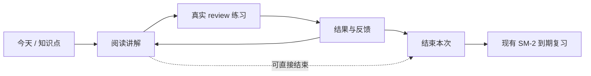

# 学习板块：课件阅读、练习与结果

日期：2026-10-23（Asia/Shanghai）。工作区：studyhub-redesign；基线提交：584e25ae。
状态：设计待确认；用户已选择先学后测、允许直接做题，并认可复用现有 review、作答记录与 SM-2 的架构。本文补齐 Study-Mate 参考后的讲解设计和落地边界，加入用户要求的本地 gpt-image 图像讲解；已做一次隔离接口探测，尚未修改产品实现。

## 1. 目标与已确认决定

把固定的 explain → retell → practice → summary 表单改成以内容为主的学习体验：先读讲解，需要时就地问，随时开始实际练习，结束后自动看结果，再由现有排程安排复习。

- 移除独立复述环节、跳过原因和学习依据面板；笔记与总结均不作为推进条件。
- 会话位置只有 reading / practice / results；生命周期只有 active / paused / completed。产品分别显示阅读中 / 练习中 / 结果，进行中 / 已暂停 / 已结束。
- 学习会话只管理目标、位置、运行关联和暂停结束，不另建题库、评分、掌握度、排程或聊天系统。
- 继续同一课程、目标和资料版本的未完成会话，保留刚完成的防重复开始与请求重放规则。
- 旧会话中的复述、总结、笔记、作答、请求回执完整保留；结束本次学习不表示已经掌握。
- 复杂机制讲解时可以按需生成配图，用户也可以主动要求画图解释。文字继续使用 gemini-3.8-flash-high，图片走同一本地后端的独立图像模型能力，不另建教学或内容库。

## 2. 参考依据与适配范围

### 2.1 Study-Mate

参考仓库：https://github.com/Miaotofu01/Study-Mate 。本次通过 GitHub 页面、原始文件和树 API 阅读，树快照为 d8114f38363272852b339d6788b2f8f007243b43。属于源码与文档研究，未安装或运行该项目。

主要参考：

1. [课件设计规范](https://github.com/Miaotofu01/Study-Mate/blob/d8114f38363272852b339d6788b2f8f007243b43/preset/skills/lesson-design/SKILL.md)：教材式说明，解释概念的条件、推理、例子和边界，按内容组织小节，有用时配图，不机械套模板。
2. [局部提问规范](https://github.com/Miaotofu01/Study-Mate/blob/d8114f38363272852b339d6788b2f8f007243b43/preset/skills/local-qa/SKILL.md)：围绕正在读的内容答一小段，答后仍在原阅读位置。
3. [课件内容格式](https://github.com/Miaotofu01/Study-Mate/blob/d8114f38363272852b339d6788b2f8f007243b43/docs/规范/课件内容格式.md)：内容与呈现分离，讲解和题目分工，题库保持唯一来源。
4. [阅读端呈现](https://github.com/Miaotofu01/Study-Mate/blob/d8114f38363272852b339d6788b2f8f007243b43/docs/规范/阅读端呈现.md)：正文优先、辅助区按需展开、选段上下文明确、阅读不中断。

借鉴内容和交互原则，不照搬其目录、题型、学习进度判断或专用 Markdown 指令。该项目以数学和计算机学习为主；StudyHub 还承载生理等课程，讲解需要适配概念、机制、比较和情境应用。

### 2.2 学习研究

[Dunlosky 等 2013](https://journals.sagepub.com/doi/10.1177/1529100612453266)支持把练习测试和分散练习作为核心；[IES 实践指南](https://ies.ed.gov/ncee/wwc/PracticeGuide/1)建议结合解题示例和独立作答。研究支持原则，不给本产品固定题量、固定讲解字数或某个掌握分数背书。

## 3. 架构选择

| 方案 | 优点 | 代价与判断 |
| --- | --- | --- |
| A. 在现有大纲、全书、局部解释和 review 上组成学习界面 | 知识点与内容同源，编辑和解释可复用，题与评分仍只有一份 | 需要拆出阅读组件和调整会话状态；本文采用，符合用户已确认的职责收敛方向 |
| B. 新建独立讲解库和一套课程阅读器 | 可以完全独立设计 | 与已有全书、个人补充和版本历史重叠，不采用 |
| C. 以多轮聊天驱动整个学习流程 | 追问自由 | 稳定讲解和阅读位置难以呈现，容易再次让用户依赖对话推进，不作为主线 |

A 的具体实现细节属于本设计建议，不把未确认的界面样式当作用户已批准。前端沿用现有 React、样式与 Markdown 能力；不增加框架或依赖。

## 4. 学习界面与讲解组织

### 4.1 进入和阅读

从今天、大纲或待巩固入口进入同一学习界面，明确课程和知识点。正文占主要空间，小目录可收起；顶栏提供返回、当前位置和暂停；主要动作是做题检验。退出当前界面保存已确认的进度，不自动结束本次学习。

讲解内容按知识需要安排，典型顺序为：

- 一句话目标或切入问题，说明本节要理解什么；没有可靠目标时不编造独立目标字段。
- 从已知概念引入，首次出现的重要术语给出够用的定义。
- 讲清关系、机制或推理，列出必要前提与适用范围。
- 用例子、图表或对照说明；公式与文字结合，避免图片只作装饰。
- 必要时指出容易混淆的地方，随后进入实际练习。

这是写作质量标准，不强制每个知识点出现五个同名栏目。简单概念可以短，复杂机制可分小节展开；不把整门课压成五条摘要，也不把无关背景塞进当前内容。教学情境和类比超出原文时，沿用现有“资料以外”的标注规则。

该标准接入现有 course-book 生成与局部解释的提示和质量检查，首轮不新增另一套讲解生成器。已生成的全书继续可读，不因升级界面被批量重写；只有用户明确生成或更新时采用新标准。

保留现有生成层、个人文字和解释块的所有权。用户笔记不被重生成覆盖；已写好的讲解打开即读，不因打开、翻页、切换阶段而调用模型或重写内容。

### 4.2 就地解释

选中正文或点击知识点上的解释入口，提供“讲简单一点”“举个例子”“解释这段”等少量动作及自由提问。继续使用现有 generation.courseBook.explain、BookAsk、AI block 与写入队列。新入口只是现有解释能力的消费方。

解释请求携带固定课程、知识点、选段及其版本；响应始终归属于发起目标，用户切到别处时不串入新正文。解释生成期间保留当前文字、阅读位置和输入；局部显示进度、取消和重试，完成后就地呈现，不整页闪烁或跳回顶部。

宿主支持主会话时可沿现有“发给主会话”能力深入讨论；独立预览不假装具备宿主聊天能力，使用现有局部解释路径。失败只影响该解释，不阻断继续阅读或做题。

### 4.3 内容定位与缺内容

outline 目标通过现有节点 ID / bk key 读取全书对应的正文，保留节点与文件版本引用；不再把全文复制进 session.records.explain 当作另一份可编辑课件。

topic 目标先用现有题目到大纲节点的明确映射定位正文。不按标题相似度自动绑定：若有多个节点，展示相关小节；若无映射，先展示确实关联的资料片段和已有题目讲解，并标明尚无完整讲解。资料片段来自该目标的引用与定位，不拿整份课程资料冒充精确片段。

无完整讲解时仍可直接做题。准备完整课程内容通过现有大纲/全书生成入口显式发起；首轮不添加独立 topic 讲解库，也不在进入一个知识点时自动生成整本书。无稳定全书节点时不调用依赖该节点的解释接口，提供原文和课程内容准备入口。

### 4.4 图像讲解

#### 触发与教学内容

两种入口均属于已有讲解能力：

- **讲解时按需配图**：用户明确生成或追问当前知识点讲解时，文本模型判断复杂的结构关系、空间位置、因果链或反馈回路是否需要一张图，给出图示计划；简单定义和已有清晰图示不再生成。只针对当前知识点的一次讲解动作，首轮最多一张，不在全书批处理、进入页面或翻页时逐点自动生图。入口允许关闭本次配图。
- **用户主动画图**：知识点和选段提问增加“画图解释”，也接受“用图讲清楚这个机制”等自由请求；复用同一图示计划与生图任务，不要求用户先生成一段重复讲解。无稳定正文节点时沿用 4.3 的内容准备入口，不创建游离于课程之外的图片记录。

图示计划只使用当前课程、选段和确实关联的资料，明确要说明的问题、必要结构、箭头方向、促进或抑制、关键标注和图注；原资料没有的结构、数值和结论不让生图模型补齐。资料外类比明确标为类比。简单流程或已有资料图能表达清楚时优先复用，不为装饰调用生图模型。

图片与简短文字解释一起出现，提供图名、图注、可访问的替代文字和“AI 生成示意图”标记；用户应能从文字读懂关键关系，不必依赖辨识图片中的小字。图片沿用 StudyImage 的缩放查看、懒加载和失败呈现，宽度自适应，不把正文挤成窄栏，也不假定服务端一定返回所请求的尺寸或比例。它补充讲解，不用于评分或判定掌握。

#### 模型与调用边界

本地后端为用户现有 EasyCLIProxyAPI，服务地址运行时配置为 http://127.0.0.1:8317/v1；不改写其安装、代理配置或 OAuth 凭据。文本模型保持 gemini-3.8-flash-high；图像模型单独配置，初始建议采用本次实测成功的 gpt-image-2，可显式换成后端提供的其他图像模型，不静默换模型或提供商。

采用已有后端直接提供的 POST /images/generations，不经文本 chat/completions 伪装生图，也不另起图片代理服务。由 StudyHub 服务端发请求，浏览器只调用 StudyHub 的受控 operation，不持有 API key。第一版是文生图，不加入上传原图编辑、连续图片编辑或网络搜图。

增加窄接口 generation.courseBook.illustrate（最终 DTO 在实施计划中固定），接收课程、稳定知识点、选段/指令、资料版本、请求标识及可选替换块；输出沿现有模式返回 jobId / blockId。文本 explain 和图示任务共享内容定位与资料片段解析，但图像结果不进入只接受短文本 JSON 的 readAi。宿主适配器显式提供独立的 image capability，预览和隔离 DSH 均需接入；缺少该能力时明确显示不可用，不能把宿主的普通文本模型当作图片模型。

图像任务使用现有 Job 注册、排队、取消、任务控制台和 gateway 的 step / external-request 观测。图像能力返回字节、实际 MIME、模型路由和后端确实提供的 usage；已有调用记录记录一次图像调用，不把图片 base64 存入任务文本输出，也不凭空折算 token 或金额。图像请求有独立于文本请求的超时预算，具体值在实施计划中固定并按实际耗时验收。

首次进入时不调用模型。自动配图只在当前用户发起的讲解请求内执行：先保存并显示成功的文字，再启动可独立取消和重试的图片 Job，配图失败不会撤回文字或把已成功的讲解标成全部失败；界面仍可阅读和做题。打开已有内容不会补跑缺图；用户需要时点“画图解释”或重试。

#### 保存、重试与版本

首轮沿用现有 AI block、materials.book.aiWrite 和课程全书写入队列，将单张受限 raster data URI 与图注保存到目标知识点的补充文件；复用保留、删除、替换、版本历史和 JSON 备份。不新增图片集合、图库或文件服务，不往 learningSessions 写图片正文。同一块保存图像模型 ID、资料版本和简短图示指令等必要来源信息，不保存 key、认证响应或完整 HTTP 请求。

复用 lib/study-image-policy.js 的格式识别和单图 2 MiB 上限，服务端从实际字节判定 MIME，核对非空 base64 与有效 raster 文件后再写入；后端返回的格式、大小和实际字节不一致时不能直接相信请求参数。现有正文验证、文本长度截断和导出路径需逐项接入受限图文校验，不把长 base64 送入 readAi 的 6000 字截断，也不通过全局放宽普通文字限制绕过。文本模型继续使用现有 omitLocalImagePayloads，不能声称读到了未传入的图片内容。

优先请求适合阅读的单张压缩图；若实际结果超出 2 MiB，则不写半成品，保留文字并说明可调整图示后重试。第一版不增加压缩依赖、自动连续降质或无限重生机制，也不保存后端临时 URL 作为永久内容。当前适配器只消费已验证的 b64_json 响应；其他格式给出可见失败，后续有真实使用需要再扩展。

同一 requestId 的重放和同一目标/版本/图示指令的并发点击只复用原任务，资料内容哈希和选段锚点参与身份，不能直接沿用当前未包含资料版本的 planAi.key。任务内已收到且校验成功的字节可在写入失败后重试保存，避免再付费生成；不增设跨重启缓存。重新画一张是用户明确的新动作。网络超时、取消或重启后不能确认上游结果时，只标记本地已停止或失败，不自动补发新的付费生图请求，也不承诺撤销已提交的上游调用。

保存前重新检查课程、知识点、资料版本和目标锚点，通过现有写入队列落到发起目标。用户切到其他知识点不改变请求归属；目标已删除或资料改变则拒绝把旧图写入新内容，并给出重新发起入口。已有图在重新生成时继续显示，只有新图成功保存后才替换，不清屏、不重置滚动位置。

#### 本地接口核验记录（2026-10-23）

- 用户给出的目录名仍为 EasyCLIProxyAPI-v0.3.2-Windows-amd64；portable-app.json 报告桌面版 0.3.46，cpa-core/cpa-gui-meta.json 报告 core v8.0.35，而 core-version.txt 为 8.0.34。此处只记录文件差异，不据此断言运行进程的精确版本。
- GET /v1/models 实际列出 gpt-image-1.5、gpt-image-2 及若干 2.5 别名；列出模型本身不代表每个别名都已验证可生成。
- 对 /v1/images/generations 发送空 prompt 返回 400、prompt is required，确认路由与校验已存在。
- 对 gpt-image-2 发起一次真实负反馈室温调节示意图请求，n=1、quality=low、size=1024x1024、请求 WebP；约 45.78 秒后返回 data[0].b64_json、generation_id 与 usage 等字段。实际 output_format 为 png，PNG 魔数一致，1,298,113 字节（约 1.24 MiB），在现有 2 MiB 上限内。已查看图片，中文标注可读；这是单次接口与样图核验，不代表医学配图正确性或产品端到端验收完成。
- 隔离结果位于 output/qa/image-explanation-20261023/summary.json 和 negative-feedback.png，未写入任何学习库。报告只保存模型、格式、耗时、字节量和响应字段名，无认证信息。输出目录不提交 Git。
- 协议设计参考 [CLIProxyAPI v8.0.35 图像处理源码](https://github.com/router-for-me/CLIProxyAPI/blob/v8.0.35/sdk/api/handlers/openai/openai_images_handlers.go)，其 generations 路由转发图像参数并组织 b64_json 结果；这是上游标签源码参考，与上面的本机实测分别记录。

## 5. 练习、结果与中断

### 5.1 做题

阅读不设文字门槛，可直接进入练习。learning-session 继续通过受控 study 端口关联真实 review run，作答、评分、同轮订正、题目快照、SM-2 均由 study 负责。

每批默认以少量题目开始，初始建议上限 5 题；由实现计划固定具体选择规则并复用现有队列配置，不新增第二套选题器。返回阅读后继续同一 run；用户明确开始下一批才建立新 run，不把未答完的 run 默认为新一轮。

提交前不默认呈现本题答案，提交后沿用实际反馈。需要补学时回到关联阅读小节；没有明确映射就打开本次知识点正文，不能声称精确定位。当前题和已答内容保留。

没有题目时给出“继续阅读”“生成题目”“结束本次”入口，生成题目复用现有资料出题任务；不存在虚拟 run，不要求填跳过原因。

### 5.2 结果

本批答题结束后直接呈现结果，不要求返回四步弹窗手动推进，也不要求提交总结。结果页提供继续补学、再练一批和结束本次；读完但没有练习也可以结束。

结果查询聚合所有带 learningSessionId 的 runs 与 attempts，不只看最后一个 runId。显示作答覆盖、首答表现、同轮订正、仍未完成的内容，以及已存在的后续 due_at；不同题型和评分方式不强行折成一个无依据的分数。下一次复习时间来自实际排程，不编一个默认日期。

区分：仅阅读（未检验）、部分作答、已完成本批练习。不会因为滚到页底、点了结束、看了解析或同轮答对，就额外增加掌握度。

### 5.3 会话位置与生命周期

| 动作 | 会话位置 | 生命周期与副作用 |
| --- | --- | --- |
| 首次开始 | reading | active；纯开始不调用模型 |
| 开始/继续练习 | practice | active；关联实际 run，无题则仍可阅读 |
| 回看讲解 | reading | 保留 run，不关闭或重置题目 |
| 本批结束/查看本次结果 | results | 仍为 active，允许继续补学或下一批 |
| 暂停/恢复 | 原位置 | paused / active，不生成、不新增 attempts |
| 结束本次 | results | completed；未答题目记为未完成，不新增作答或评分 |

关闭页面只离开，暂停是显式动作，结束是另一显式动作。结果页与已结束是不同概念。已经结束的记录只读；再次学习通过 start 创建新会话。

明确结束时若该会话仍有关联的未关闭 run，通过 study 的 review.end 关闭会话自己的 run。会话结束和 run 关闭需在现有事务内完成，添加最小 action grant / writesFor 声明；不能直接从会话模块改写 runs，也不能关闭其他独立练习。

## 6. 后端边界与接口建议

| 模块 | 职责 |
| --- | --- |
| curriculum / course-book | 知识点结构、阅读正文、个人补充、版本和到原文的定位 |
| generation / jobs | 讲解生成、局部解释、图像讲解与出题；文本和图像能力分别适配，共用现有任务生命周期 |
| learning-session | 目标、phase、status、阅读定位、请求回执和 review 关联 |
| study | run、attempt、真实评分和 SM-2 排程，仍为唯一所有者 |
| learning-records / today | 学习结果和待巩固的只读投影、继续与到期建议 |

建议在既有运行时和现有 learning-session API 上增量扩展；图像操作增加在 generation 内，不建立服务端程序或新的持久化集合：

- 新会话 schemaVersion:2；新增 phase 与阅读位置（稳定 heading/section 锚点）。status 沿用现有 active/paused/completed，完整正文不存入会话。
- get 返回统一阅读/练习/结果视图，包括原目标、阅读引用、可继续的 run 与结果查询入口；查询不触发隐式迁移或模型任务。
- move 负责明确切换 reading / results 及保存阅读位置；practice.start 原子处理进入 practice 和 run 关联，不允许直接 move 伪造一个练习。
- finish 是显式、支持 requestId/version 的结束操作；结果以关联学习事实计算，不接受前端提交“已掌握”。
- pause 和 start 延续现有幂等与冲突规则；start 复用适配后的未完成旧会话，不能因 schemaVersion 不同再造重复学习。

具体 DTO 字段名及是否复用已有 move/位置保存工具交给实施计划；必须保持读写所有权、权限声明、备份和工具注册一致。局部解释与已有 run 的复用要沿用资料版本校验，隐藏学习依据面板不意味着删除后台版本检查。

## 7. 旧数据兼容

读取旧 schemaVersion:1 时只计算展示位置：explain / retell 对应 reading，practice 对应 practice，summary 对应 results；原 status、records、step、outcome、request 回执保留。旧 completed 仍然结束，不变成可编辑会话。

用户继续旧 active/paused 会话时，第一次成功的新写操作在同一事务内保存 schemaVersion:2、phase 与旧数据归档信息；保留旧 records 和原四步 step 作历史，不删字、不自动推进旧步骤，不补“系统跳过”记录。每个新写操作携带现有 version/requestId；升级和该动作同时成功或同时回滚。旧 completed 只读查看，不批量迁移。

旧未完成 practice 继续关联的真实 run，沿用已验证的已关闭未完成 run 重开规则；旧 retell 不再要求填写，旧 summary 的已有文字出现在历史详情，结束无需新填总结。

旧四步 record/advance 兼容调用保留在 schemaVersion:1；对已经进入 v2 的会话，旧推进命令返回明确的不兼容状态并要求读取新视图，不能同时推进两套状态机。新 API 的具体错误码在实施计划中确定。

已有重复会话不自动合并/删除。今天的推荐对相同课程、目标与资料版本的未完成会话按 start 相同的最近创建规则归并为一个继续入口；记录页仍保留全部历史。

## 8. 实施顺序与验收

按后端状态与兼容 → 阅读内容与文本解释接入 → 图像能力、持久化与两种入口 → 实际练习及结果 → 今天/记录联动的顺序，每阶段完成定向验证与独立审查后继续。

验收必须覆盖：

1. 不填任何复述、笔记或总结就能阅读、做题、结束；界面无复述/跳过原因/学习依据面板。
2. 同目标连点和重试不重复；暂停、关闭后继续；只读查看不升级、不生成；切课程或切知识点的晚响应不串内容。
3. 真实讲解可读，局部解释留在原位，已有个人内容不被改写；缺讲解、无题、模型失败都有可用动作。
4. 练习与结果使用真实 run/attempt；结束部分练习不伪造答案或掌握；同轮订正与后续间隔复习区分；不改动无关 run。
5. 旧 retell / summary / practice 会话继续、已完成旧历史、备份恢复和跨库隔离；采用用户指定资料的独立副本进行最终模型与隔离 DSH 验收。
6. 当前复杂机制讲解按需配一张图、简单内容不自动配图、主动画图均可用；自动配图可关闭，打开已有内容和切换知识点不发起生图。无图像能力或模型失败时阅读、文本解释和练习仍可用。
7. 图像连点与请求重放复用任务，取消后晚响应不写入，失败重试不重复保存，资料版本变化时拒绝过期图；实际 PNG / WebP 的识别、损坏或超限内容拒绝、替换时旧图可见均验证。
8. 用指定本地后端和一份用户资料的独立副本，完成复杂机制图的生成、显示与放大、刷新恢复、保留/删除和 JSON 备份恢复，并在隔离 DSH 下重复完整链路；确认正文和文本模型请求未被图片字节截断或污染。只验证模型列表或样图不算功能交付。

开发不安装到真实 DSH，不写真实学习库。原预览库已含用户导入资料，不清空或播种测试数据。文本模型继续使用用户指定的本地兼容接口和 gemini-3.8-flash-high；图像使用同一后端的独立 gpt-image 路由，凭据仅运行时提供。

本轮不加入多代理教学调度、项目实验系统、跨课程画像、自动网络搜图、新题型或自定义流程编排。讲解所需图表优先复用原资料与现有渲染能力，需要生图时按 4.4 执行；复制参考项目代码需另核许可证并保留相应声明，本方案只借鉴设计。
